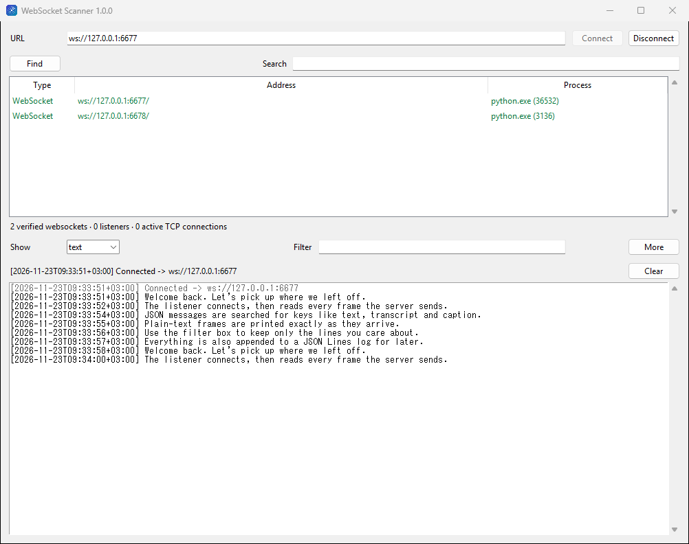
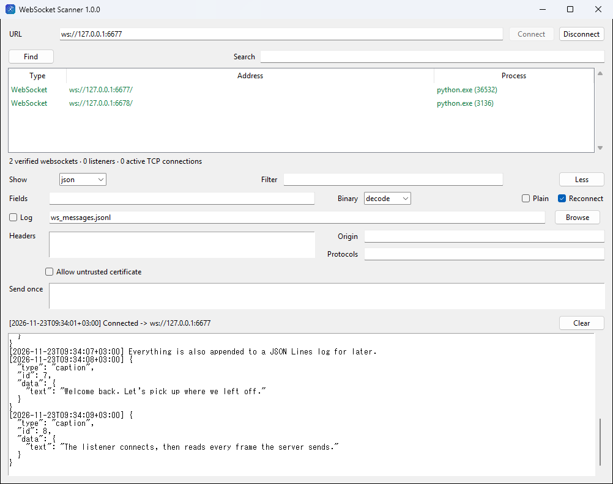

<p align="center">
  
</p>

<h1 align="center">WebSocket Scanner</h1>

<p align="center">
  Find WebSocket servers running on your machine, connect with a double-click,
  and read the text inside their messages.
</p>

<p align="center">
  <a href="https://github.com/KonyAHS/Websocket-Scanner/releases/latest"></a>
  <a href="https://github.com/KonyAHS/Websocket-Scanner/actions/workflows/ci.yml"></a>
  
  <a href="LICENSE"></a>
</p>



## Features

- **Finds local sockets.** Lists listening ports and active TCP connections with their process,
  then probes each listener and marks the ones that accept a WebSocket upgrade (green rows).
  Socket discovery works on Windows; listening works everywhere.
- **Pulls out the text.** For JSON messages it looks for keys like `text`, `transcript`,
  `caption` and `content` at any depth. You can also point it at exact paths such as
  `choices.0.delta.content`.
- **Filters and logs.** Keep only lines matching a regex, and append every message to a
  [JSON Lines](https://jsonlines.org/) file for later.
- **Handles real servers.** Custom headers (or headers read from environment variables), origin,
  subprotocols, `wss://` with self-signed certificates, a message to send on connect, and
  automatic reconnects with backoff.
- **GUI or terminal.** Same options in both.

## Install

**Windows, no Python needed:** download `WebSocketScanner-<version>-windows-x64.exe` from the
[latest release](https://github.com/KonyAHS/Websocket-Scanner/releases/latest) and run it.

**With Python 3.10 or newer:**

```sh
pip install "websocket-scanner @ git+https://github.com/KonyAHS/Websocket-Scanner"
ws-scanner-gui          # window
ws-scanner --help       # terminal
```

**From a clone:**

```sh
git clone https://github.com/KonyAHS/Websocket-Scanner
cd Websocket-Scanner
pip install -r requirements.txt
python ws_listener.py --gui      # or double-click run.bat on Windows
```

## Use the window

1. The socket list fills in on launch. Press **Find** to refresh, and type in **Search** to
   narrow it by port, process name or address.
2. Double-click a row to copy its address into **URL**, then press **Connect**.
3. Pick what to **Show** (`text`, `json` or `raw`) and type a regex in **Filter** if you only
   want some lines.
4. **More** opens headers, origin, subprotocols, JSON fields, logging and a message to send on
   connect.



Want something to try it on? Start the bundled demo server, which streams sample captions:

```sh
python examples/demo_server.py      # ws://127.0.0.1:6677
```

## Use the terminal

```sh
# Print text from a local server (logs to ws_messages.jsonl by default)
ws-scanner ws://127.0.0.1:6677

# Only one JSON path, no timestamps, no log file
ws-scanner wss://example.com/stream --field data.caption --plain --no-log

# Keep lines that mention "error", send a subscribe message first
ws-scanner ws://localhost:8080/ws --match "(?i)error" --send '{"op":"subscribe"}'

# Auth header taken from an environment variable, so it stays out of shell history
ws-scanner wss://api.example.com/ws --header-env "Authorization=API_TOKEN"
```

Running from a clone, use `python ws_listener.py` in place of `ws-scanner`. All options are listed
by `--help`. The URL can also come from `WS_URL`, and the log path from `WS_LOG_FILE`.

Each log line looks like this:

```json
{"timestamp":"2026-11-23T09:15:02+03:00","binary":false,"json":true,"extracted":[{"path":"$.data.text","text":"Hello"}],"data":{"data":{"text":"Hello"}}}
```

> [!NOTE]
> Logs hold everything the server sent, which may include private data. `*.jsonl` files are
> ignored by git in this repository.

## Develop

```sh
pip install -e ".[dev]"
pytest
ruff check . && ruff format --check .
```

Releases are automated. Bump `__version__` in `ws_listener.py`, add a section to
[CHANGELOG.md](CHANGELOG.md), then push a matching tag:

```sh
git tag v1.0.1 && git push origin v1.0.1
```

The [release workflow](.github/workflows/release.yml) runs the tests, builds the Windows
executable, wheel and source archive, and publishes them with checksums.

## License

[MIT](LICENSE)
